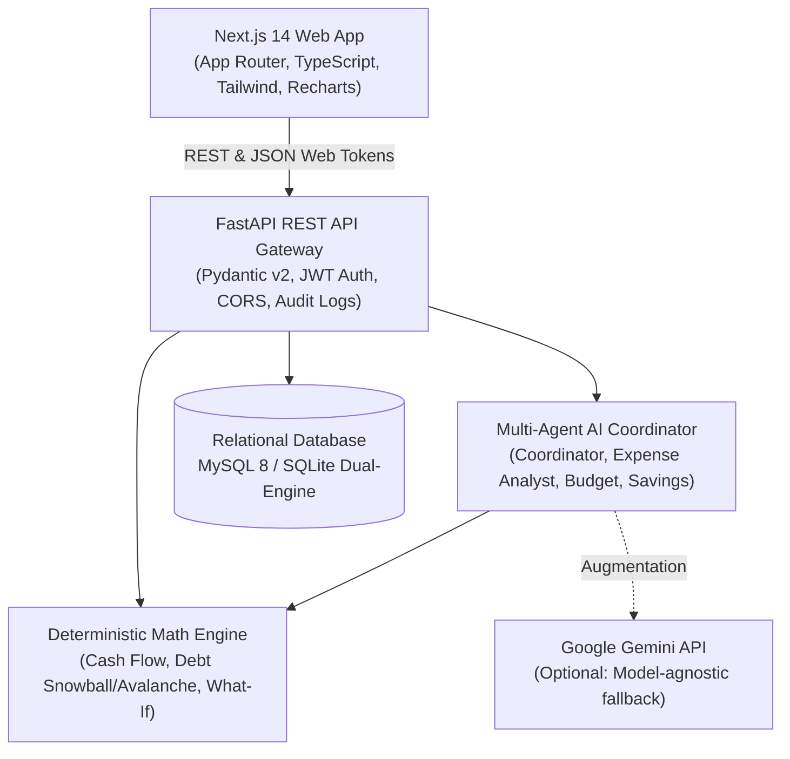

# FinWise AI
### Production-Oriented AI-Powered Personal Financial Planning Platform

[](https://fastapi.tiangolo.com)
[](https://nextjs.org)
[](https://www.typescriptlang.org)
[](https://www.python.org)
[](https://www.mysql.com)
[]()

FinWise AI is an intelligent financial planning platform built for individuals, students, young professionals, and households. It combines deterministic personal finance math, an interactive ledger dashboard, and an orchestrated multi-agent AI assistant to deliver transparent, actionable financial insights.

Initially optimized for Indian users with Indian Rupee formatting (`₹`, `en-IN`), the application is architected for extensible multi-currency and global localization.

---

## 1. System Architecture



---

## 2. Core Capabilities & Routes

### Public Experience
- `/` — Premium landing page highlighting features, architecture, and security disclosures.
- `/features` — In-depth breakdown of the 6 core pillars.
- `/security` — Honest privacy and security architecture breakdown.
- `/login` — Email and password sign-in with lockout protection and a demo account button.
- `/register` — Account registration with a live password-strength checklist.
- `/verify-email` — 6-digit email code that confirms a new account.
- `/forgot-password` and `/reset-password` — Password recovery with a one-time code sent to the user's inbox.

### Authenticated Financial Suite
- `/onboarding` — Multi-step wizard collecting initial baseline, income, needs/wants, and savings goals.
- `/dashboard` — Executive command center: net cash flow, savings rate, 6-month historical trend charts, expense breakdown, and upcoming bills.
- `/transactions` — Full ledger management: search, filters, pagination, duplicate-detecting CSV statement imports, and streaming CSV ledger export.
- `/budgets` — Category-level budget allocations with 80% warning triggers, over-budget alerts, and 1-click previous month copying.
- `/goals` — Goal tracking with required monthly contribution quotas, progress visualization, and idempotent contribution logging.
- `/bills` — Recurring subscriptions and obligations tracker with 1-click "Mark as Paid" cadence advancement.
- `/debts` — Debt payoff simulator comparing **Debt Avalanche** (interest minimization) vs **Debt Snowball** (psychological wins).
- `/assistant` — Multi-agent AI copilot with interactive prompt chips, multi-agent step trace inspection, and pending recommendation cards requiring user approval.
- `/forecasts` — Interactive What-If simulator with income/expense sliders, one-time shocks/windfalls, multi-month projections, and Recharts area charts.
- `/reports` — Audited monthly and annual financial statements with categorical weight tables, budget adherence, printable PDF layout, and CSV export.
- `/settings/profile` — User display name, currency (`INR`, `USD`, `EUR`, `GBP`), timezone, and financial baselines.
- `/settings/security` — Password change form with strength validation and active session directory.
- `/settings/privacy` — Machine-readable complete JSON data export package and account deletion modal.

### Administrative Control Plane
- `/admin` — System health (API, DB, AI provider), global statistics, and system audit trail.
- `/admin/users` — User administration directory with role badges and registration logs.
- `/admin/agents` — Multi-agent execution monitoring, latency tracking, and topology diagnostics.

---

## 3. Technology Stack

| Layer | Technologies |
|---|---|
| **Frontend** | Next.js 14 (App Router), React 18, TypeScript, Tailwind CSS, Lucide Icons, Recharts, React Hook Form, Zod |
| **Backend** | Python 3.12+, FastAPI, Pydantic v2, SQLAlchemy 2, Alembic, Uvicorn, Pytest, HTTPX |
| **Database** | MySQL 8 (production) with automatic SQLite dual-mode (`sqlite:///./finwise.db`) for zero-dependency local dev |
| **Security** | JWT (HS256), Bcrypt password hashing, email-verified accounts, hashed single-use email codes (OTP), strong password policy, account lockout and rate limiting, strict CORS, security headers, Audit Event Logging |
| **AI Multi-Agent**| Hybrid Multi-Agent Graph (Coordinator, Expense Analyst, Budget Planner, Savings Planner, Policy Validator) |

---

## 4. Quickstart Guide (Local Development)

You can run FinWise AI locally without installing MySQL; SQLite is enabled by default for rapid setup.

### Prerequisites
- Node.js 20+ and npm
- Python 3.11+

### Step 1: Clone & Setup Backend
```bash
cd backend

# Create virtual environment
python -m venv .venv

# Activate virtual environment
# Windows (PowerShell):
.venv\Scripts\Activate.ps1
# macOS/Linux:
source .venv/bin/activate

# Install dependencies
pip install -r requirements.txt

# Run database migrations
alembic upgrade head

# Start FastAPI server (runs on http://127.0.0.1:8000)
uvicorn app.main:app --reload
```
Interactive OpenAPI documentation will be accessible at: `http://127.0.0.1:8000/docs`

### Step 2: Start Frontend
In a separate terminal:
```bash
cd frontend

# Install dependencies
npm install

# Start Next.js development server
npm run dev
```
Open your browser at `http://localhost:3000`.

### Demo account
Use the **Try the demo account** button on `/login` (`demo@finwise.ai`).
There is no built-in admin password. To create an admin, set `DEFAULT_ADMIN_PASSWORD` in the backend environment.

### Email codes (sign-up and password reset)
Every account must confirm its email, and forgotten passwords are reset with a 6-digit code sent to the inbox.
- **Local development:** set `APP_ENV=development` in `backend/.env`. Codes are printed in the backend console, no email provider needed.
- **Production:** configure an email provider (`BREVO_API_KEY`, `RESEND_API_KEY`, or `SMTP_*`; see `backend/.env.example`). Without one, the API refuses to send codes instead of silently dropping them.

---

## 5. Docker Production Deployment

FinWise AI includes a multi-container Docker configuration with MySQL 8, the FastAPI backend, and Next.js frontend.

```bash
# Build and run all services in detached mode
docker-compose up -d --build

# Inspect running containers
docker-compose ps

# View backend logs
docker-compose logs -f backend
```

Services exposed:
- Frontend: `http://localhost:3000`
- Backend API: `http://localhost:8000`
- MySQL Database: `localhost:3306`

---

## 6. Running Automated Tests

A comprehensive Pytest test suite verifies deterministic calculations, API authentication, transactions, and multi-agent coordination.

```bash
cd backend
# With virtual environment activated:
pytest -v
```

**Test Coverage Summary:**
- `tests/test_calculations.py`: Net cash flow, savings rate, budget usage, debt compounding, cash-flow forecasting simulation.
- `tests/test_api_auth_transactions.py`: JWT login, registration, transactions CRUD, duplicate detection.
- `tests/test_agents_and_planning.py`: Multi-agent orchestration, recommendation generation, approval lifecycle, and safety boundaries.

---

## 7. Multi-Agent AI Safeguards & Philosophy

1. **Deterministic Priority:** The AI never invents arithmetic. Cash-flow totals, debt amortization, and forecast balances are calculated strictly in pure Python.
2. **Read-Only Authorization:** AI agents can only read data explicitly owned by the authenticated session.
3. **Approval Before Mutation:** Recommendations generated by agents (e.g. adjusting a budget limit or increasing an emergency fund goal) enter a `pending` state and require manual user confirmation before updating records.
4. **Resilient Vendor Fallback:** If `GEMINI_API_KEY` is not provided, the platform automatically activates rule-based deterministic heuristics, guaranteeing zero downtime.

---

## 8. License

This project is licensed under the MIT License.
